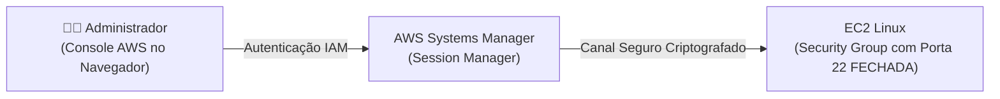

# Lab AWS - Acesso Remoto Seguro e Administracao com Systems Manager (Sem SSH)

Prática realizada durante a formação **AWS re/Start (Escola da Nuvem)** demonstrando como administrar servidores Linux e Windows na AWS sem precisar abrir portas SSH (22) ou RDP (3389) para a internet.

Toda a configuração de acesso e auditoria foi realizada diretamente pelo **Console da AWS**, utilizando o **AWS Systems Manager (SSM)** e políticas do **IAM**.

---

## 🔒 O Problema vs. A Solução

* **Método Tradicional (Vulnerável):** Abrir a porta 22 (SSH) na internet, expor o servidor a ataques de força bruta e precisar gerenciar chaves privadas (`.pem`).
* **Método com AWS Systems Manager (Zero-Trust):** O servidor EC2 possui apenas o agente do SSM instalado e se comunica de dentro para fora com a AWS. O Security Group fica com **zero regras de entrada**, eliminando a superfície de ataque externa.



---

## 🛠️ Passo a Passo no Console da AWS

### 1. Criar a Role no IAM (Console IAM)
1. Vá em **IAM** > **Funções (Roles)** > **Criar função**.
2. Tipo de entidade confiável: **Serviço da AWS** > Caso de uso: **EC2**.
3. Adicionar política de permissão: pesquise e marque a política gerenciada pela AWS:
   - `AmazonSSMManagedInstanceCore`
4. Nome da função: `Role-EC2-Acesso-SSM`.
5. Clique em **Criar função**.

### 2. Criar a Instância EC2 sem Portas Abertas (Console EC2)
1. Vá em **EC2** > **Executar instância**.
2. AMI: **Amazon Linux 2023** (já vem com o SSM Agent pré-instalado de fábrica).
3. Par de chaves: **Prosseguir sem par de chaves** (não precisa de arquivo `.pem`!).
4. Configurações de rede (Security Group):
   - Criar um novo Security Group chamado `sg-sem-ssh`.
   - **Remover a regra de SSH porta 22**. Deixe a tabela de regras de entrada completamente vazia.
5. Em **Detalhes avançados**:
   - Campo **Perfil de instância do IAM**: selecione a função criada `Role-EC2-Acesso-SSM`.
6. Clique em **Executar instância**.

### 3. Conectar na Instância pelo Navegador (Console Systems Manager)
1. Aguarde 1 a 2 minutos para o agente do SSM sincronizar com a AWS.
2. Vá em **AWS Systems Manager** > menu lateral **Fleet Manager** ou **Session Manager**.
3. A instância aparecerá com status de ping online.
4. Selecione a instância e clique em **Start session** (Iniciar sessão).
5. O console abre uma tela de terminal preta direto no navegador como usuário `ssm-user`, com acesso completo ao Linux!

---

## ⚡ Execução de Comandos em Lote com Run Command

Além da sessão interativa, o Systems Manager permite rodar comandos em dezenas de servidores ao mesmo tempo sem precisar logar em nenhum deles:

1. No menu do **Systems Manager**, clique em **Executar comando (Run Command)**.
2. Selecione o documento: `AWS-RunShellScript`.
3. No campo de parâmetros de comando, digite os comandos desejados (exemplo de checagem de espaço em disco e atualização):
   ```bash
   df -h
   uptime
   ```
4. Escolha as instâncias por tag ou seleção manual.
5. Clique em **Executar**: o console exibe o status de sucesso e a saída de texto de cada servidor instantaneamente.

---

## 🧹 Limpeza de Recursos (Teardown)
1. No console EC2, selecione a instância criada e clique em **Estado da instância > Finalizar instância**.
2. No console IAM, exclua a função `Role-EC2-Acesso-SSM`.
3. Exclua o Security Group `sg-sem-ssh`.
